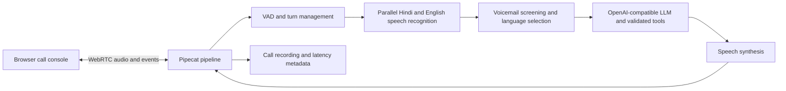

# EMI Reminder Voice Agent

A browser-based bilingual voice agent for an overdue EMI reminder. It supports Hindi and English, verifies the caller before discussing account details, handles common call outcomes, and records call audio and per-turn latency.

## Features

- Hindi and English speech recognition run in parallel, with automatic language selection and mid-call switching.
- A scripted opening identifies the AI and discloses call recording, then verifies whether the intended customer is speaking.
- Account details are withheld until identity is verified. Promise-to-pay dates and call outcomes are validated by application logic.
- Supports already paid, promise to pay, refusal, unrecognized loan, callback, wrong number, stop-calling, and voicemail outcomes.
- Barge-in support lets callers interrupt the agent. The conversation context tracks the words played before interruption.
- The `/call` console includes live calling and a call-history dashboard: select a conversation ID, play its recording, inspect the transcript, tool results, language and voicemail decisions, and view per-turn latency. Turn rows can seek into the recording.
- Calls are recorded as stereo WAV files, with caller audio on the left and agent audio on the right. Call metadata is saved separately.

## Requirements

- Python 3.12 or later
- [uv](https://docs.astral.sh/uv/)
- An OpenAI-compatible chat completions endpoint and API key
- An Azure Speech resource with speech-to-text and text-to-speech enabled
- A browser with microphone access

## Run

```bash
uv venv
uv sync
cp .env.example .env
```

Set the required values in `.env`:

```dotenv
LLM_BASE_URL=
LLM_API_KEY=
LLM_MODEL=
AZURE_SPEECH_KEY=
AZURE_SPEECH_REGION=
```

`LLM_BASE_URL` may be left blank when using the default OpenAI endpoint. Use `LID_MODEL` to select a separate model for language identification; it defaults to `LLM_MODEL`. Optional settings such as turn timing and language-switch behavior are documented in `.env.example`.

Start the application and open the call console:

```bash
uv run bot.py -t webrtc
```

Open [http://localhost:7860/call](http://localhost:7860/call), allow microphone access, and click **Call**. The demo uses a sample customer record and begins in that record's preferred language.

Run the test suite without API credentials:

```bash
uv run pytest -q
```

## Architecture



The application runs as a single Pipecat process. Two streaming speech recognizers process each caller turn; the selected transcript and language are passed to the conversational model. The response is synthesized and returned to the browser over WebRTC. A voicemail gate can handle a detected voicemail before the conversational flow begins.

The LLM is responsible for conversation and tool selection. Application code enforces identity checks, promise-date rules, permitted call outcomes, and spoken number formatting. Loan details are not included in the model context before identity verification.

Completed calls are indexed from local JSON metadata. The history endpoints expose the call list, detail, and WAV audio only to requests from the same machine; recordings and metadata stay in `recordings/`.

## Call flow

1. The agent waits for a human greeting or identifies voicemail.
2. It introduces itself, discloses recording, and asks whether it is speaking with the named customer.
3. If the caller is someone else, the agent does not disclose account details and can arrange a callback or end the call.
4. After identity verification, the agent gives the reminder and handles the caller's response.
5. A promise-to-pay date must be in the future and within the allowed window; the agent reads the date back for confirmation.
6. The call ends with a validated outcome and a recorded disposition.

## Evaluation results

The following are observed project results, not service guarantees. Stage sample counts differ because some calls ended before every stage completed.

| Area | Result |
|---|---|
| Voicemail classification | 99.66% precision and 98.93% recall |
| Language identification | 99.0% agreement with reference labels; not an independently human-labeled accuracy figure |
| Conversation behavior | 115 of 115 scripted scenario runs passed |
| Barge-in | About 0.7 seconds to stop agent speech in observed calls |

### Latency by stage

| Stage | Samples | Median (ms) | P90 (ms) |
|---|---:|---:|---:|
| End of speech to final STT transcript | 20 | 908 | 1,053 |
| STT final to resolved language/transcript | 20 | 136 | 609 |
| End of speech to endpoint decision | 20 | 1,194 | 3,308 |
| LLM request to first token | 28 | 232 | 661 |
| TTS request to first audio | 28 | 1,416 | 1,900 |
| End of speech to agent starts speaking | 20 | 3,231 | 5,323 |

The speech-synthesis time to first audio is the largest measured component. These figures are a snapshot from an earlier local demonstration run; that call history has been cleared from this shareable project. Results vary with model, region, network, speech, and configuration.

## Voicemail and language handling

Voicemail screening is a custom frame-processing gate, not Pipecat's built-in voicemail detector. It scores final transcripts from both Hindi and English recognizers using bundled character n-gram model weights, while also tracking speech segments, silence, and beep signals. A detected voicemail waits for a beep or quiet before playing a short scripted message; the decision and its signals are saved with the call. The raw training corpus and training scripts are not included.

The detector can miss new carrier messages, unusual wording, or announcements that neither recognizer transcribes clearly. A short human statement can also resemble an announcement; ambiguous cases favor continuing the conversation. To assess it on real calls, create a separately approved and human-labeled sample of first-turn audio/transcripts, report precision and recall with confidence intervals, and review false voicemail decisions separately because they end a human call prematurely.

Language handling starts from the preferred language in the customer record. Both recognizers run in parallel; gates and a heuristic tier handle clear evidence, with an OpenAI-compatible LLM fallback for uncertain turns. Short turns and code-mixed speech are held by a word-count/confidence threshold; explicit language requests can switch immediately. A switch updates the language prompt and TTS voice and is recorded with its evidence. Very short or noisy turns may keep the previous language for one reply, and a recognizer may transliterate one language into the other script.

## Requirement checklist

- [x] Greeting identifies the assistant, purpose, and recording; identity is checked against a sample customer record.
- [x] Reminder amounts and dates are formatted in words from the customer record.
- [x] Already-paid, promise-to-pay, wrong-number, and stop-calling branches record a disposition; additional outcomes are supported.
- [x] Promise-to-pay uses a server-side tool that accepts only a future date within 30 days, returns structured confirmation, and reads it back before closing.
- [x] Per-turn stage latency is recorded, with median/P90 summaries above and in the history dashboard.
- [x] Custom voicemail gate, scripted message, disposition, and decision signals are implemented.
- [x] Hindi/English recognition, preferred-language start, switch hysteresis, TTS/prompt updates, and decision evidence are implemented. No third language is included.
- [x] Full calls are saved as stereo WAV with JSON metadata, including call ID, timestamps, disposition, transcript, language timeline, voicemail decision, tools, and latency. The greeting includes a recording disclosure.

## Demonstration notes

- **One thing to improve:** the Hindi neural voice is clear but can sound flat, and English terms embedded in Hindi may receive Hindi pronunciation. I would compare a more expressive multilingual voice and tune pronunciation for common loan terms.
- **First priority with one more day:** validate the voicemail and language decisions on an approved, independently human-labeled sample, then address the largest measured latency component, TTS time to first audio.
- **Not included:** carrier telephony, CRM writes, cloud recording upload, a third language, and silent-caller reprompts. The demo uses browser WebRTC and a sample customer record.

## Files and outputs

- `bot.py`: application entry point and Pipecat pipeline.
- `agent/`: call flow, language selection, speech formatting, voicemail screening, and recording support.
- `agent/voicemail_model.json`: bundled voicemail classifier weights. Raw training data and training utilities are excluded.
- `web/call.html`: browser call console.
- `recordings/`: generated call recordings and metadata.

Each completed call writes a stereo WAV and a JSON metadata file under `recordings/`; the history tab lists newest calls first. Previous local recordings have been removed, so make a fresh call to populate the dashboard and create a sample recording. Recordings and metadata may contain sensitive audio or transcript data. Treat them as confidential, use appropriate access controls, and do not commit them, credentials, or customer data to source control.

## Deployment considerations

This repository is a browser-based demonstration, not a complete telephony or CRM integration. Before adapting it for real callers, replace the sample customer record, connect approved customer and case-management systems, define retention and access controls for recordings, and review applicable consent, privacy, and calling requirements. Validate speech quality, language handling, latency, and outcomes for the intended deployment environment.